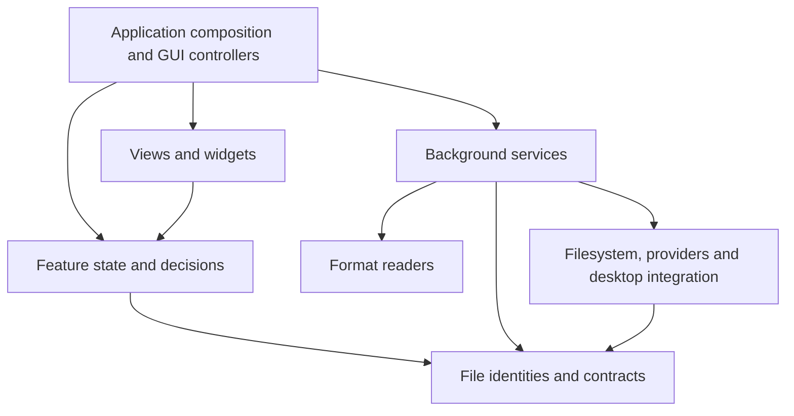

# Architecture refactoring plan

Status: proposed; implementation has not started.

This document records the architecture decision and an incremental migration
plan. [README.md](../README.md#architecture) describes the current architecture;
[TODO.md](../TODO.md) remains the backlog and the place for open feature decisions.

## Decision

Organize fyle around shared file and format modules, cohesive application
features, and a thin GUI application layer. Within each feature, distinguish
state and decisions from blocking execution and GUI integration.

Keep the existing binary crate. Extract specific shared contracts and readers,
then regroup files as their ownership becomes clear. Feature-specific logic
stays together: preview state belongs with preview, and transfer conflict policy
belongs with transfers.

The investigation used Luna for module inspection, Sol for intermediate analysis
and a challenge of the proposed boundaries, and Astra for the overall decision.

### Alternatives considered

- Broad horizontal layers such as `domain/`, `services/` and `ui/` make dependency
  rules visible, but spread each feature across large directories and require
  substantial file movement before improving ownership.
- Independent feature packages keep workflows together, but file identities,
  metadata and readers already have consumers across several features.
- Shared foundations plus feature modules fit those existing relationships.
  They allow independently reviewable extractions without a crate split or a
  repository-wide move.

## Responsibility map

| Area | Owns | Existing code affected |
| --- | --- | --- |
| File identities and contracts | Locations, entry metadata, sorting, listing requests and results; no disk or provider access | Shared parts of `fs_ops`, `location`, `listing`, `model` |
| Formats | Format-specific data, parsing, metadata extraction and enforced decoding limits | Reusable parts of `preview/*`, EXIF, RAW and archive readers |
| System integration | Local filesystem operations, remote providers, desktop applications, accounts, xattrs and external programs | `fs_ops`, `remote/*`, desktop/MIME modules and specialized process adapters |
| Application features | Browsing, preview, editing, search, transfers, tools and settings, with explicit state and execution responsibilities | Existing model and service modules |
| GUI components | Feature panes, reusable visual components, focus and rendering | `panel`, `icon_view`, `*_view` and menu components |
| Application composition | Startup, windows, command routing, dialogs, background scheduling and coordination between features | `main`, `commander/*` and focused GUI controllers |

These are ownership boundaries. Each area can contain several focused modules;
it does not need one umbrella module or a universal interface.

## Dependency direction



Controllers capture requests, schedule background work and deliver results to
models. Models decide whether results still apply. Views display the resulting
state and forward input. GPUI entities, task handles and image resources belong
to GUI integration; request generations, selection rules and queue policies
belong to independent models.

Shared contracts and pure state models must not import GPUI or concrete provider
implementations. Format readers return plain data and do not depend on preview
presentation. Readers and services may perform bounded I/O using Rust and
third-party library APIs; they run off the UI thread. A universal wrapper around
all filesystem access is not required.

## Current boundaries to repair

### Shared entry data inside filesystem operations

[`fs_ops.rs`](../src/fs_ops.rs) contains `Entry`, `Attrs`, sorting and native
filesystem operations. Remote providers and panel models import shared values
through this module. `Attrs::owner()` reads the account database, while
`Attrs::from_meta()` translates native filesystem metadata.

Extract plain values and pure ordering into `entry.rs`. Keep metadata conversion
and account lookup as explicit adapter functions, so the shared types themselves
do not expose hidden I/O methods.

### Listing contracts coupled to the panel model

[`model.rs`](../src/model.rs) imports listing requests and snapshots, while
[`listing.rs`](../src/listing.rs) imports `model::Sort`. Move `Sort` beside the
entry ordering rules and separate listing contracts from listing execution.
The Folder model should consume snapshots without depending on the service that
obtains them.

### Addresses coupled to execution modules

[`location.rs`](../src/location.rs) embeds `remote::Location` and calls archive
member validation. Extract pure remote-address and archive-member validation
before regrouping provider and archive execution. Preserve native path bytes,
symlink spelling, typed identities and persisted encodings.

### Shared format knowledge owned by preview

[`panel/metadata.rs`](../src/panel/metadata.rs) obtains EXIF through
`preview::exif_fields`. Both columns and preview should consume a shared EXIF
reader. That reader owns semantic fields; consumers own their labels and
presentation.

RAW extraction already serves thumbnails and preview, but
[`raw_preview.rs`](../src/raw_preview.rs) combines scanning with cache writes.
Keep scanning, materialization and cache policy distinct when extracting the
shared reader.

### Feature decisions embedded in GUI code

[`preview_view.rs`](../src/preview_view.rs) owns target changes, reloads,
page/sheet selection and stale-result checks alongside GPUI resources and
rendering. A `PreviewSession` model can own those decisions. Similarly,
`panel/metadata.rs` combines queue policy, metadata reading and GPUI scheduling.

## Ownership details

### Format models and preview representations

The existing document, workbook and Parquet representations are bounded and
sometimes lossy. Preserve those limits and their sample semantics during
extraction. They must not be presented as complete models of the source formats.
Future conversions would need suitable complete or streaming contracts rather
than truncated preview tables.

Preview retains selection of previewers, fallback behavior, presentation content
and display-specific transformations. Extract additional format readers one at
a time when their responsibilities and consumers justify the boundary.

### System integration and tools

Use focused adapters for local files, remote providers, desktop associations and
external programs. PDF rendering, remote CLI calls and tool execution have
different output and cancellation requirements. Preserve specialized adapters;
share process primitives where concrete duplication and compatible contracts
justify them.

Tools already have a useful context -> discovery -> offers -> planning ->
execution flow; retain it. Planning can perform documented read-only probes,
such as `just --summary`, and must continue to run in the background. See
[tools.md](tools.md).

`jobs` and `transfer` are workflows that perform I/O. Separate their pure
decisions where useful without classifying their execution code as pure state.

### GUI components and application composition

Distinguish application panes from reusable widgets. A folder panel or editor
is a feature component; a badge or shared visual control can be a widget.
Keep scheduling and resource ownership in focused GUI controllers and rendering
and event forwarding in views.

Commander composes capabilities and coordinates commands. Every user-visible
command remains represented by `Cmd` in `menus.rs`, with action mapping in
`commander::keys::action_for` and shared menu, palette and help behavior.

## Fit with the open TODO

The backlog supports this direction and adds several architectural constraints.
The items below remain open decisions or future work; mapping them here does not
authorize starting them.

| TODO area | Where it fits | Boundary the design should preserve |
| --- | --- | --- |
| Shared file-type and directory-kind detection; JetBrains Open With; Open With follow-ups and icons | A shared, bounded classification service consumed by icons, previews, Open With, Properties and tools | Return evidence and possibly several facets, not one guessed type. File-format recognition and directory/project facts are related but distinct. Keep platform application discovery in adapters. |
| File inspection / Properties, PDF and sheet navigation, directory space view, tabular preview growth, XLS/ODS bounds | An inspection capability beside Preview, backed by format readers and cancellable services | Properties returns structured metadata independently of whether a content view exists. A preview sample stays a sample; conversion or inspection cannot treat it as a full dataset. Incremental reads need explicit bounded request/result contracts. |
| Tabular conversions; possible DOC support | Tool planning and execution using readers/writers with conversion-suitable contracts | Do not wire conversions to preview-only `Content` or its row/character caps. Choose formats and conversion policy as each TODO item specifies. |
| Remote follow-ups, remote/archive drag materialization, upload of edited copies | Source access and materialization workflows coordinated by the relevant feature | Keep typed source identity separate from a local cache path. Freshness, cancellation, source capabilities and any writeback/conflict policy must be explicit. A cached copy does not itself grant permission to write back. |
| Grouped related assets | A panel presentation over existing entry identities, with group selection policy consumed by operations | Preserve each member's typed identity. Decide per feature whether an action applies to one member or the group before expanding copy, move, rename or delete targets. |
| Tools output/history, growing-file follow, embedded terminal | Tools execution/reporting, a bounded appendable text model if shared by follow mode and tool logs, and a separate terminal/PTY backend | Text output capture and a terminal emulator have different contracts. Keep both out of generic widgets and preserve tools' planned-action boundary. |
| Keymap presets, localization, editable columns, workspace layouts, window scaling | Settings and workspace models, command catalog and focused views | Keep command IDs and setting keys stable. Localization should translate semantic IDs and arguments at the presentation edge rather than store translated labels in shared contracts. Keep Properties independent of Preview layout. |
| Linux/macOS/Windows integration and packaging | Platform adapters, application startup/build configuration and platform-specific views | Add platform behavior only with the associated support work. Preserve current Windows compilation without extending it as part of this refactor. |

The detection TODO points to one useful distinction: a format reader answers
“what data can I read from this file?”, while classification combines bounded
evidence such as names, extensions and signatures to answer “what might this
item be?” Directory facts such as project markers are another kind of evidence.
Open With, icons and tools can consume that shared evidence without owning the
probes themselves. Keep classification multi-faceted so ambiguous items can
match more than one relevant capability.

The inspection TODO also changes how the formats boundary should be used. A
future inspection result should carry structured values (for example image
metadata or Parquet schema) and remain separate from `Preview::Content`, which
describes what the viewer can display. Both can use the same reader while
remaining independently requestable, cancellable and bounded.

Several preview follow-ups and conversions make streaming a future contract
concern. A reader should be able to request a bounded region or batch and report
whether more data is available; a view decides which rows, pages or sheets to
request. Request identity must let the controller reject stale results. The
current single-page/single-sheet `PreviewSession` should not force future readers
to load whole files or restrict rendering to only one in-flight resource, but
continuous PDF scrolling and larger samples remain separate TODO features.

Remote quick view, native Open With, drag-and-drop and edited-copy upload share a
source-versus-local-copy problem. A materialization result needs to retain the
typed source and the cache path separately and give callers enough information
to check freshness. Each action still decides whether a local copy is sufficient
or whether writeback is supported. Cross-remote move, upload and conflict
behavior belong in transfer workflows, not in a file-format reader.

Grouped files likewise affect both presentation and operation planning. Model a
group as references to entries, leaving existing `Location` values as the
identity of each physical member. Only after grouping and selection rules are
decided should jobs expand a requested action into member targets.

Localization affects the shared command and error boundary: stable command IDs,
setting keys and structured error context should survive translation. Existing
user-facing strings need not all be migrated in this architecture refactor;
the localization TODO should plan that work explicitly. A bounded text-output
model may serve both tool logs and follow mode if its needs match. An embedded
terminal needs its own PTY and input/rendering design, as already noted in TODO.

## Migration plan

Each slice is independently reviewable and can contain several focused commits.
Preserve behavior while changing ownership; avoid combining the migration with
new features or dependency changes.

1. **Extract shared entry values and ordering.** Introduce `entry.rs` for
   `Entry`, plain `Attrs`, `Sort`, `SortKey` and comparison functions. Leave
   metadata conversion and account lookup in adapters. Update consumers and
   move existing ordering tests with their code.
2. **Separate listing contracts and address semantics.** Introduce
   `listing/contracts.rs`, keeping execution and caches in the listing service.
   Remove the model/listing dependency cycle. In a separate commit, isolate
   pure remote-address and archive-member validation before regrouping their
   execution modules.
3. **Establish reader and classification boundaries.** Start
   with `formats.rs` and `formats/exif.rs`, consumed by previews and panel
   metadata. Preserve RAW fallback, existing limits and display behavior.
   Separate RAW scanning from materialization/cache policy where required by
   the extraction. Do not implement the open generalized-detection TODO in this
   step; document its multi-facet contract for when that decision is taken.
   Move other readers individually as their contracts become clear.
4. **Separate feature state from GUI execution.** Extract `preview/session.rs`
   for target identity, reloads, page/sheet selection and result acceptance.
   Keep debounce, task cancellation, editor/notebook resources and focus in GUI
   integration. Separately split metadata queue policy, metadata reading and
   GPUI scheduling, preserving bounds and generation handling.
5. **Make later feature seams ready without prebuilding them.** If Properties is
   approved, define its independent structured inspection result before adding
   another renderer. If large-file preview or conversions are approved, design
   bounded incremental reader contracts before extending samples. If remote
   writeback or grouped assets are approved, settle freshness/capability and
   action-target rules before changing transfer execution.
6. **Clarify remaining service ownership.** Extract `settings/persistence.rs`
   while retaining comment-preserving saves. Keep tools' planning/execution
   boundary explicit. Scope navigation lifecycle extraction separately because
   cancellation, pending destinations and panel swapping cross several paths.
7. **Finish GUI organization and documentation.** Separate `FileTable` from
   the shared panel shell, for example into `panel/table_view.rs`. Group feature
   panes and shared visuals where useful. Keep composition and command wiring
   in Commander. Update the README architecture map as each boundary lands.

Start with entry values and listing contracts: these foundations are used across
the application. Preview session extraction follows as a contained feature step.
Create module files using the existing `foo.rs` plus `foo/` convention.

## Validation and acceptance

Measure success by ownership and dependency changes:

- Shared contracts import no GPUI or concrete providers, and expose no hidden
  filesystem or account lookups.
- Folder consumes listing contracts without a dependency cycle through sorting.
- Shared format readers have no dependency on preview presentation.
- State transitions and queue policies can be tested independently of GPUI,
  network access and optional programs.
- Existing behavior, settings, resource limits, cancellation and error messages
  remain intact.

Regression coverage should preserve ordering, unknown sizes, local/remote/archive
identity, path spelling and persistence. Preview model tests should cover
same-target suppression, line-only changes, reloads, page/sheet bounds, resets,
failures and rejection of obsolete completions. Metadata tests should cover
queue/cache bounds and generation invalidation. Format tests should retain
truncation and decoding limits; settings tests should retain comments and
unrelated keys.

Before each implementation commit, run the repository's required checks:

```sh
cargo fmt --check
cargo clippy --all-targets -- -D warnings
cargo test
```

Check affected GUI flows in the Linux app using scratch configuration and data
directories. Include rapid preview target changes, search-hit line reveal,
PDF/workbook navigation, notebook resource cleanup and panel focus/selection
where the corresponding slice changes wiring.

## Scope

This is a refactoring proposal. It does not start the undecided Properties,
generalized format detection, conversion, continuous PDF scrolling or sheet-tab
features in TODO.md. Retain existing Windows compilation without extending its
support. New crates, dependencies and a general-purpose filesystem or process
framework are not part of this plan.
