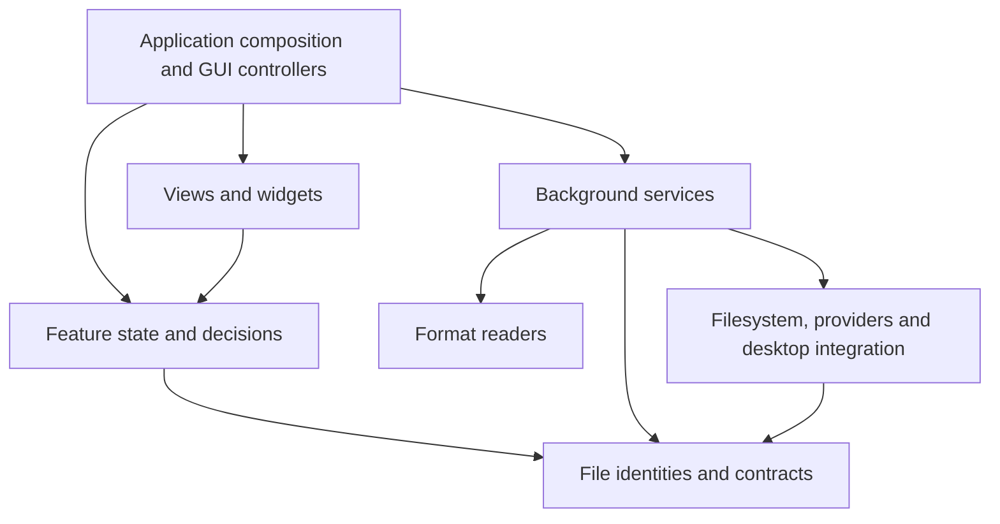

# Architecture refactoring plan

Status: the listed migration slices (1, 2a, 2b, 3a, 4a, 4b, 6a, 6b,
6c, 6d, 7a and 7b) are complete. The remaining steps are conditional
guidance for future features, not work authorized by this plan alone.

This document records the architecture decision, the completed migration and
boundaries for future work. [README.md](../README.md#architecture) describes
the current architecture; [TODO.md](../TODO.md) is the source of truth for
open work and owner decisions. Read the relevant ownership section here when
changing one of those boundaries.

## Decision

Organize fyle around shared file and format modules, cohesive application
features, and a thin GUI application layer. Within each feature, distinguish
state and decisions from blocking execution and GUI integration.

Keep the existing binary crate. Extract specific shared contracts and readers,
then regroup files as their ownership becomes clear. Feature-specific logic
stays together: preview state belongs with preview, and transfer conflict policy
belongs with transfers.

### Alternatives considered

- Broad horizontal layers such as `domain/`, `services/` and `ui/` make dependency
  rules visible, but spread each feature across large directories and require
  substantial file movement before improving ownership.
- Independent feature packages keep workflows together, but file identities,
  metadata and readers already have consumers across several features.
- Shared foundations plus feature modules fit those existing relationships.
  They allow independently reviewable extractions without a crate split or a
  repository-wide move.

## Responsibility map

| Area | Owns | Existing code affected |
| --- | --- | --- |
| File identities and contracts | Entry metadata, sorting, listing requests/results, local/remote/archive address semantics | Shared parts of `fs_ops`, `location`, `listing`, `model` |
| Formats | Format-specific data, parsing, metadata extraction and enforced decoding limits | Reusable parts of `preview/*`, EXIF, RAW and archive readers |
| System integration | Local filesystem operations, remote providers, desktop applications, accounts, xattrs and external programs | `fs_ops`, `remote/*`, desktop/MIME modules and specialized process adapters |
| Application features | Browsing, preview, editing, search, transfers, tools and settings, with explicit state and execution responsibilities | Existing model and service modules |
| GUI components | Feature panes, reusable visual components, focus and rendering | `panel`, `icon_view`, `*_view` and menu components |
| Application composition | Startup, windows, command routing, dialogs, background scheduling and coordination between features | `main`, `commander/*` and focused GUI controllers |

These are ownership boundaries. Each area can contain several focused modules;
it does not need one umbrella module or a universal interface.

## Dependency direction



Controllers capture requests, schedule background work and deliver results to
models. Models decide whether results still apply. Views display the resulting
state and forward input. GPUI entities, task handles and image resources belong
to GUI integration; request generations, selection rules and queue policies
belong to independent models.

Shared contracts and pure state models must not import GPUI or concrete provider
implementations. Listing contracts import standard types plus entry and
location values. Remote parsing and archive member validation live in pure
`location` modules; provider and archive execution modules consume those helpers.
Format readers return plain data and do not depend on preview presentation.
Readers and services may perform bounded I/O using Rust and third-party library
APIs; they run off the UI thread. A universal wrapper around all filesystem
access is not required.

## Boundaries established by the migration

### Shared entry data inside filesystem operations

[`entry.rs`](../src/entry.rs) now contains `Entry`, plain `Attrs`, `Sort`,
`SortKey` and pure ordering. `fs_ops.rs` retains native filesystem operations,
`attrs_from_metadata(&fs::Metadata)`, and `owner_name(Option<u32>)` adapters.
Owner lookup remains in the existing background metadata worker.

Consumers import shared values directly from `entry.rs`; the shared types do
not expose hidden filesystem or account lookups. `LinkState` is unchanged.

### Listing execution and address semantics

[`listing/contracts.rs`](../src/listing/contracts.rs) owns listing requests,
rows, snapshots and outcomes; [`model.rs`](../src/model.rs) imports those values
directly. `Sort` comes from `entry.rs`. Address semantics are owned by pure
submodules under `location/`, preserving the existing typed `Location` API.

### Addresses coupled to execution modules

[`location.rs`](../src/location.rs) owns the typed address union and delegates
address details to [`location/remote.rs`](../src/location/remote.rs) and
[`location/archive.rs`](../src/location/archive.rs). Provider execution keeps
its compatibility alias; archive execution imports pure helpers. Native path
bytes, symlink spelling, typed identities and persisted encodings are covered.

### Shared format knowledge owned by preview

[`formats/exif.rs`](../src/formats/exif.rs) owns ordered semantic EXIF values
and bounded RAW fallback. Preview maps tags to its existing labels;
[`panel/metadata/exif.rs`](../src/panel/metadata/exif.rs) maps tags to column
keys and compositions. The shared reader has no preview or panel dependency.

[`formats/raw.rs`](../src/formats/raw.rs) owns extension policy, scan limits and
largest-decodable-JPEG selection. [`raw_preview.rs`](../src/raw_preview.rs)
retains source freshness checks, cache identity and atomic materialization;
EXIF fallback parses selected JPEG bytes without writing to that cache.

### Preview, Properties and tool registries

The [provider migration](format-organization/implementation-plan.md) provides
pure contribution contracts in `data_providers` and a GPX/FIT provider-owned
bundle consumed by both Properties and View. `data_providers/geo.rs` prepares
typed quantities from the bounded native reader, preserving per-value origin
and completeness; existing feature adapters still own presentation. These
contracts do not replace the separate feature registries. The column catalog
now resolves persisted IDs to built-ins, registered native providers or
unavailable placeholders, keeping specialized built-in rendering/sorting and
the existing bounded metadata queue. Provider columns are display-only. Its
[progress log](format-organization/progress.md) records the implemented boundary
and next slice; Tools retains its separate planning/execution contract.

`extensions/manifest.rs` validates versioned package declarations against those
contracts before script access. `extensions/loading.rs` loads only explicitly
named packages, bounds manifest/script bytes, checks canonical package-local
paths and retains structured per-package errors. It stores script text without
evaluation. `extensions/catalog.rs` loads explicitly enabled config packages
before GPUI starts and prepares immutable columns, Properties providers and
viewer handles from one package snapshot and shared supervisor. Startup diagnostics retain native paths and I/O errors until main
formats them for the status line. Unavailable saved IDs remain removable
placeholders. `extensions/properties.rs` retains typed independent field results;
`extensions/preview.rs` grants package access only to the exact original local
regular-file identity. Remote/archive materialization never grants that access.
`extensions/protocol.rs` defines typed bounded frames and field/completeness
validation; `results.rs` retains presentation-specific prepared values and
completeness. Internal protocol v2 preserves the existing column Lua API.
`broker.rs` owns the selected native regular file and charges byte
and call budgets; `model.rs` owns FIFO admission and cancellation while keeping
active occupancy until explicit cleanup. `extensions/worker.rs` evaluates only
the requested declared callback under Lua allocation/instruction limits, with
strict result schemas and no ambient file/process/module APIs. The Linux
supervisor owns one child at a time and pumps nonblocking pipes, including Init
writes and post-result exit, under cancellation/deadlines. Child cleanup precedes
slot release. The reserved same-executable helper dispatch runs before settings
or GPUI. Main retains the shared supervisor and explicitly shuts it down after
the event loop returns. Column callbacks preserve result completeness; a pure
`columns/cell.rs` projection prepares partial/lower-bound text and hover reasons.
Properties keeps native groups and extension sections separate under its existing
cancellable session. Preview retains specialized built-in priority, then tries
package/contribution IDs in deterministic order before generic text/binary.
Absent/unavailable viewers decline; failures remain visible diagnostics.
`preview/session.rs` captures original identity and owns explicit full-load
cancellation on replacement, reload, suspension and drop. A path-only preview
call remains native-only. `preview_scene` validates bounded static layout,
selectable text, typed tables and paths before `preview_scene_view` renders them;
rendering performs no I/O or Lua execution.

Keep three domain-specific registries with the same basic extension shape:
providers or tools register in order, expose a predicate for applicability, and
return plain model data or an action. Do not introduce a universal registry
trait; preview, inspection and tool planning have different result and failure
semantics.

`preview::Registry` selects the first matching `Previewer`, because one preview
content representation owns the display. `properties::Registry` runs every
matching local-file `PropertyProvider` and collects independent groups, so a
file can expose facts from several formats; a failed reader contributes its
own failed group without hiding other results. Listing, filesystem/symlink and
EXIF facts remain the inspection's baseline sections. `tools::Registry`
continues to offer all applicable tools, then plans only the selected tool.
Each feature owns its matching and execution contract.

Columns and Properties remain separate presentation contracts. When both need
the same format fact, share the semantic reader and stable fact identity, then
map that fact into column descriptors or the richer Properties groups at
each consumer. Do not infer columns automatically from arbitrary property
groups.

### Feature decisions embedded in GUI code

[`preview/session.rs`](../src/preview/session.rs) now owns target identity,
line-only changes, reloads, page/sheet selection and stale-result checks for all
three load streams. [`preview_view.rs`](../src/preview_view.rs) retains debounce,
tasks, focus, editor/notebook resources and rendering.

[`panel/metadata/model.rs`](../src/panel/metadata/model.rs) now owns metadata
requests, field selection, coalescing, concurrency limits and generation-scoped
cache policy. [`panel/metadata/reader.rs`](../src/panel/metadata/reader.rs) reads
optional local values; [`panel/metadata.rs`](../src/panel/metadata.rs) retains
GPUI scheduling. Old-generation workers count toward the four-worker bound
until completion; stale results never populate the current cache.

## Ownership details

### Format models and preview representations

The existing document, workbook and Parquet representations are bounded and
sometimes lossy. Preserve those limits and their sample semantics during
extraction. They must not be presented as complete models of the source formats.
Future conversions would need suitable complete or streaming contracts rather
than truncated preview tables.

Preview retains selection of previewers, fallback behavior, presentation content
and display-specific transformations. Extract additional format readers one at
a time when their responsibilities and consumers justify the boundary.

### System integration and tools

Use focused adapters for local files, remote providers, desktop associations and
external programs. PDF rendering, remote CLI calls and tool execution have
different output and cancellation requirements. Preserve specialized adapters;
share process primitives where concrete duplication and compatible contracts
justify them.

Tools already have a useful context -> discovery -> offers -> planning ->
execution flow; retain it. Planning can perform documented read-only probes,
such as `just --summary`, and must continue to run in the background. See
[tools.md](tools.md).

`jobs` and `transfer` are workflows that perform I/O. Separate their pure
decisions where useful without classifying their execution code as pure state.

### GUI components and application composition

Distinguish application panes from reusable widgets. A folder panel or editor
is a feature component; a badge or shared visual control can be a widget.
Keep scheduling and resource ownership in focused GUI controllers and rendering
and event forwarding in views.

Commander composes capabilities and coordinates commands. Every user-visible
command remains represented by `Cmd` in `menus.rs`, with action mapping in
`commander::keys::action_for` and shared menu, palette and help behavior.

## Fit with the open TODO

The backlog supports this direction and adds several architectural constraints.
The items below remain open decisions or future work; mapping them here does not
authorize starting them.

| TODO area | Where it fits | Boundary the design should preserve |
| --- | --- | --- |
| Shared file-type and directory-kind detection; JetBrains Open With; Open With follow-ups and icons | A shared, bounded classification service consumed by icons, previews, Open With, Properties and tools | Return evidence and possibly several facets, not one guessed type. File-format recognition and directory/project facts are related but distinct. Keep platform application discovery in adapters. |
| File inspection / Properties, PDF and sheet navigation, directory space view, tabular preview growth, XLS/ODS bounds | An inspection capability beside Preview, backed by format readers and cancellable services | Properties returns structured metadata independently of whether a content view exists. A preview sample stays a sample; conversion or inspection cannot treat it as a full dataset. Incremental reads need explicit bounded request/result contracts. |
| Tabular conversions; possible DOC support | Tool planning and execution using readers/writers with conversion-suitable contracts | Do not wire conversions to preview-only `Content` or its row/character caps. Choose formats and conversion policy as each TODO item specifies. |
| Remote follow-ups, remote/archive drag materialization, upload of edited copies | Source access and materialization workflows coordinated by the relevant feature | Keep typed source identity separate from a local cache path. Freshness, cancellation, source capabilities and any writeback/conflict policy must be explicit. A cached copy does not itself grant permission to write back. |
| Grouped related assets | A panel presentation over existing entry identities, with group selection policy consumed by operations | Preserve each member's typed identity. Decide per feature whether an action applies to one member or the group before expanding copy, move, rename or delete targets. |
| Tools output/history, growing-file follow, embedded terminal | Tools execution/reporting, a bounded appendable text model if shared by follow mode and tool logs, and a separate terminal/PTY backend | Text output capture and a terminal emulator have different contracts. Keep both out of generic widgets and preserve tools' planned-action boundary. |
| Keymap presets, localization, editable columns, workspace layouts, window scaling | Settings and workspace models, command catalog and focused views | Keep command IDs and setting keys stable. Localization should translate semantic IDs and arguments at the presentation edge rather than store translated labels in shared contracts. Keep Properties independent of Preview layout. |
| Linux/macOS/Windows integration and packaging | Platform adapters, application startup/build configuration and platform-specific views | Add platform behavior only with the associated support work. Preserve current Windows compilation without extending it as part of this refactor. |

The detection TODO points to one useful distinction: a format reader answers
“what data can I read from this file?”, while classification combines bounded
evidence such as names, extensions and signatures to answer “what might this
item be?” Directory facts such as project markers are another kind of evidence.
Open With, icons and tools can consume that shared evidence without owning the
probes themselves. Keep classification multi-faceted so ambiguous items can
match more than one relevant capability.

The inspection TODO also changes how the formats boundary should be used. A
future inspection result should carry structured values (for example image
metadata or Parquet schema) and remain separate from `Preview::Content`, which
describes what the viewer can display. Both can use the same reader while
remaining independently requestable, cancellable and bounded.

Several preview follow-ups and conversions make streaming a future contract
concern. A reader should be able to request a bounded region or batch and report
whether more data is available; a view decides which rows, pages or sheets to
request. Request identity must let the controller reject stale results. The
current single-page/single-sheet `PreviewSession` should not force future readers
to load whole files or restrict rendering to only one in-flight resource, but
continuous PDF scrolling and larger samples remain separate TODO features.

Remote quick view, native Open With, drag-and-drop and edited-copy upload share a
source-versus-local-copy problem. A materialization result needs to retain the
typed source and the cache path separately and give callers enough information
to check freshness. Each action still decides whether a local copy is sufficient
or whether writeback is supported. Cross-remote move, upload and conflict
behavior belong in transfer workflows, not in a file-format reader.

Grouped files likewise affect both presentation and operation planning. Model a
group as references to entries, leaving existing `Location` values as the
identity of each physical member. Only after grouping and selection rules are
decided should jobs expand a requested action into member targets.

Localization affects the shared command and error boundary: stable command IDs,
setting keys and structured error context should survive translation. Existing
user-facing strings need not all be migrated in this architecture refactor;
the localization TODO should plan that work explicitly. A bounded text-output
model may serve both tool logs and follow mode if its needs match. An embedded
terminal needs its own PTY and input/rendering design, as already noted in TODO.

## Migration record and conditional next steps

Each slice is independently reviewable and can contain several focused commits.
Preserve behavior while changing ownership; avoid combining the migration with
new features or dependency changes.

1. **Complete: extract shared entry values and ordering.** Introduce `entry.rs` for
   `Entry`, plain `Attrs`, `Sort`, `SortKey` and comparison functions. Leave
   metadata conversion and account lookup in adapters. Update consumers and
   move existing ordering tests with their code. This step has landed; metadata
   and account adapters remain in `fs_ops.rs`.
2. **Separate listing contracts and address semantics.** Slice 2a is complete:
   `listing/contracts.rs` owns request and result values, while execution and
   caches remain in the listing service. The panel model imports those values
   directly. Slice 2b is complete: pure remote addresses and archive members
   live under `location/`; providers retain their address compatibility alias.
3. **Establish reader and classification boundaries.** Slice 3a is complete:
   `formats/exif.rs` owns semantic EXIF values and read-only RAW fallback;
   `formats/raw.rs` selects a bounded embedded JPEG, while `raw_preview.rs`
   owns cache identity and atomic materialization. Preview labels and panel
   column composition remain at their consumers. Generalized file detection
   remains an open TODO; move other readers individually as contracts become
   clear.
4. **Separate feature state from GUI execution.** Slice 4a is complete:
   `preview/session.rs` owns target identity, reloads, page/sheet selection and
   result acceptance. Debounce, task cancellation, editor/notebook resources
   and focus remain in GUI integration. Slice 4b is complete:
   `panel/metadata/model.rs` owns queue/cache policy and request/result contracts,
   `panel/metadata/reader.rs` owns blocking reads, and `panel/metadata.rs` keeps
   GPUI scheduling. Cache, queue and worker bounds and generation handling are
   preserved.
5. **Make later feature seams ready without prebuilding them.** If Properties is
   approved, define its independent structured inspection result before adding
   another renderer. The agreed [Properties plan](properties-plan.md) records
   sibling inspector tabs, lifecycle ownership and remaining product decisions;
   implementation remains pending. If large-file preview or conversions are
   approved, design bounded incremental reader contracts before extending samples. If remote
   writeback or grouped assets are approved, settle freshness/capability and
   action-target rules before changing transfer execution.
6. **Clarify remaining service ownership.** Slice 6a is complete:
   `settings/persistence.rs` owns config-path discovery, loading, example-file
   creation and comment-preserving saves. `settings.rs` retains the schema,
   defaults, parsing and home-path expansion; callers name persistence directly.
   Tools retain their documented planning/execution boundary. Navigation lifecycle
   extraction is complete as step 6b: `navigation.rs` owns per-panel request
   generations, pending state and typed destinations. Commander keeps task
   handles, cancellation signals and remote reload generations; the source-folder
   guard remains separate. See
   [navigation-lifecycle-plan.md](navigation-lifecycle-plan.md) for the boundary
   and regressions. Step 6c removes the dormant archive controller and legacy
   test-only loading placeholders. Archive regressions now cover source rows
   retained until commit and cancelled results rejected by the active lifecycle.
   Step 6d consolidates Folder tests on `model/test_support.rs::TestFolder`,
   which drives `ListingService` and production listing/history commits using
   isolated in-memory remote fixtures. The model no longer carries test-only
   listing readers, remote cache policy, archive indexes or history/fallback
   algorithms. Failed history listings retain visits for retry, matching the app.
7. **Finish GUI organization and documentation.** Slice 7a is complete:
   `panel/table_view.rs` owns `FileTable` rendering and event forwarding.
   `panel.rs` retains header state, inputs, focus, subscriptions, Git scheduling
   and list/icon coordination; the table keeps its implementation details private.
   Slice 7b is complete: `panel/header_view.rs` renders breadcrumbs, the
   location bar and header buttons, forwarding the existing events. `FolderView`
   retains input/menu lifecycle, focus, subscriptions and event handlers; header
   rendering uses its existing handles and state. Group other feature panes and
   shared visuals where useful. Keep composition and command wiring in Commander.
   Update the README architecture map as each boundary lands.

Steps 1–4 and 6a–7b above record work already done. For future approved work,
use the relevant boundary and validation criteria below; module files follow
the existing `foo.rs` plus `foo/` convention.

## Validation and acceptance

Measure success by ownership and dependency changes:

- Shared contracts import no GPUI or concrete providers, and expose no hidden
  filesystem or account lookups.
- Folder consumes listing contracts without a dependency cycle through sorting.
- Shared format readers have no dependency on preview presentation.
- State transitions and queue policies can be tested independently of GPUI,
  network access and optional programs.
- Existing behavior, settings, resource limits, cancellation and error messages
  remain intact.

Regression coverage should preserve ordering, unknown sizes, local/remote/archive
identity, path spelling and persistence. Preview model tests should cover
same-target suppression, line-only changes, reloads, page/sheet bounds, resets,
failures and rejection of obsolete completions. Metadata tests should cover
queue/cache bounds and generation invalidation. Format tests should retain
truncation and decoding limits; settings tests should retain comments and
unrelated keys.

Before each implementation commit, run the repository's required checks:

```sh
cargo fmt --check
cargo clippy --all-targets -- -D warnings
cargo test
```

Check affected GUI flows in the Linux app using scratch configuration and data
directories. Include rapid preview target changes, search-hit line reveal,
PDF/workbook navigation, notebook resource cleanup and panel focus/selection
where the corresponding slice changes wiring.

## Scope

This record does not authorize the undecided Properties, generalized format
detection, conversion, continuous PDF scrolling or sheet-tab features in
TODO.md. Retain existing Windows compilation without extending its support.
New crates, dependencies and a general-purpose filesystem or process
framework are outside this plan.
